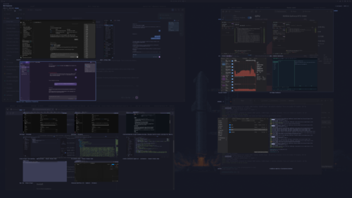
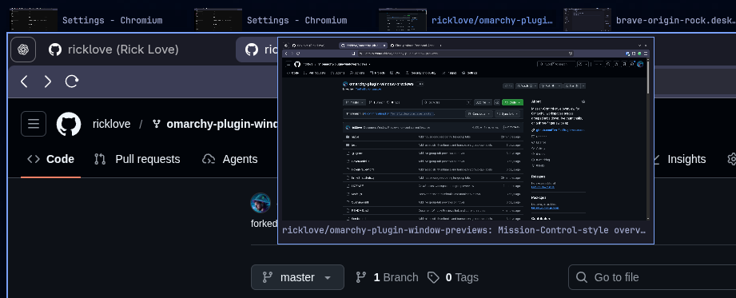

# Omarchy Window Previews

A fork of [OmaSpaces](https://github.com/TerrifiedBug/omaspaces), extending its
workspace overview with spatial window grids, group-tab snapshots, live hover
previews, and mouse drag reordering.





## Features

- A separate overview on each monitor, showing only its occupied workspaces.
- Groups expanded into grids within their existing window area. Overlapping
  ungrouped windows shrink into a grid so every window can be selected.
- Live overview thumbnails, a selection outline, and directional navigation
  between individual windows regardless of their group.
- Live group-tab previews after a 250 ms hover, at about 25% of the window size.
- Raised still snapshots capped at 60 × 36 pixels, with transparent tab labels.
- Plain left-drag tab reordering, including drags from the raised snapshot.
  An outline marks the destination; release applies the order. Super-modified
  presses bypass reordering, leaving native Hyprland drag behavior in control.
- Bounded retries for missing captures and missing monitor overlays.

## Requirements

Omarchy with its Qt Quick/Quickshell shell and Hyprland's Lua configuration.
The overview uses the shell's window screencopy support. The optional native
bridge needs a C++23 compiler, `make`, `pkg-config`, and development headers for
Hyprland, pixman, libinput, Wayland and json-c. Its headers must match the running
Hyprland version. Rebuild it after upgrading Hyprland.

The overview runs without the bridge. Native group-tab hover detection and
reordering require it; inline snapshots also depend on the bridge.

## Install

For a fresh installation:

```sh
omarchy plugin add https://github.com/ricklove/omarchy-plugin-window-previews.git --enable
cd ~/.config/omarchy/plugins/io.github.ricklove.window-previews
make -C native all check
omarchy restart shell
```

## Replace an existing OmaSpaces installation

This is a separate plugin identity. Remove the old installation before enabling
the new one, so two overview services, capture paths or tab bridges do not run.
On the desktop host, unload the old native bridge while its files still exist:

```sh
sh ~/.config/omarchy/plugins/io.github.terrifiedbug.omaspaces/native/unload.sh
omarchy plugin remove io.github.terrifiedbug.omaspaces
```

Save any local changes first: removal deletes the installed checkout. Then use
the fresh-install commands above. In `shell.json`, replace the old plugin ID
with `io.github.ricklove.window-previews`, retaining your desired settings. Update
any custom bindings that toggle the old ID. The plugin manager handles enablement,
but custom settings and bindings must be migrated explicitly.

An old swipe may remain registered in Hyprland until logout or config reload.
For the one-time migration, log out and back in when convenient after installing;
a shell restart alone does not clear that old gesture. You can use the new
keybinding in the meantime. No automatic compositor reload is performed.

For a development checkout under `Projects`, a directory symlink from the normal
installed path lets the shell load source there. The parent
[omarchy-rick](https://github.com/ricklove/omarchy-rick) repository documents that
setup. `omarchy plugin add file://...` clones the source instead of linking it.

The existing service loads the native bridge at shell startup. No new daemon,
privileged installation or Hyprland config reload is needed. QML dependency
changes may require `omarchy restart shell` to replace cached components.

## Open the overview

Swipe three fingers up, or add a binding to `~/.config/hypr/bindings.lua`:

```lua
o.bind("SUPER + CTRL + UP", "Window overview",
  "omarchy-shell shell toggle io.github.ricklove.window-previews '{}'")
```

The keybinding is an example, not installed by this plugin. Set `gesture` to
`false` if you do not want the plugin to register its swipe. Once registered,
a swipe remains until the next Hyprland config reload or restart; toggling the
setting off cannot unregister an existing gesture.

Click a thumbnail to focus its window. Arrow keys move between window thumbnails;
Tab and Shift+Tab act like right and left. Enter or Space activates the selection.
Escape or a click outside the content dismisses the overview. Digit keys 1–9
retain the workspace/group shortcut behavior inherited from OmaSpaces.

## Settings

Merge these into the existing plugin entry in `~/.config/omarchy/shell.json`:

```json
{
  "plugins": [
    {
      "id": "io.github.ricklove.window-previews",
      "gesture": true,
      "workspaces": 5,
      "tabPreviews": true,
      "tabSnapshots": true
    }
  ]
}
```

`workspaces` is clamped to 1–10 and controls the workspace range considered by
the model; the overview still filters out empty workspaces and includes occupied
extras on each monitor. `tabPreviews: false` disables native hover, inline
snapshots and tab reordering. `tabSnapshots: false` hides inline snapshots and
custom labels while keeping native hover previews and reordering available.

## Capture lifetime and development

Overview captures exist while the overview is open. Hover captures are created
after the dwell and destroyed on dismissal. Still snapshots are captured one
window at a time, reduced to tiny images, then their full-size capture loaders
are destroyed. Only visible tabs retain those still images, reused by window
address across reordering. Qt and the graphics driver may retain shared resources
independently of the plugin's capture objects.

```sh
make -C native all check
node --test --test-isolation=none test/model.test.js test/hover.test.js test/snapshot.test.js
```

After editing C++, rebuild and run `sh native/load.sh`; restart the shell after
QML changes. The loader copies the compiled bridge to a content-addressed runtime
path so reloading does not reuse an old module. Build output is Git-ignored.

See [native/README.md](native/README.md) for ABI requirements, loading, profiling,
and capture diagnostics. Useful commands:

```sh
hyprctl windowpreviews status
omarchy-shell window-previews-hover-debug status
omarchy-shell window-previews-snapshots-debug status
```

## Credits and license

Based on [OmaSpaces by TerrifiedBug](https://github.com/TerrifiedBug/omaspaces).
This fork retains upstream Git history and builds on upstream commit
`772479b243249272149e30b89085dfd14d91baee`.

MIT; the original copyright and license notice are preserved in [LICENSE](LICENSE).
